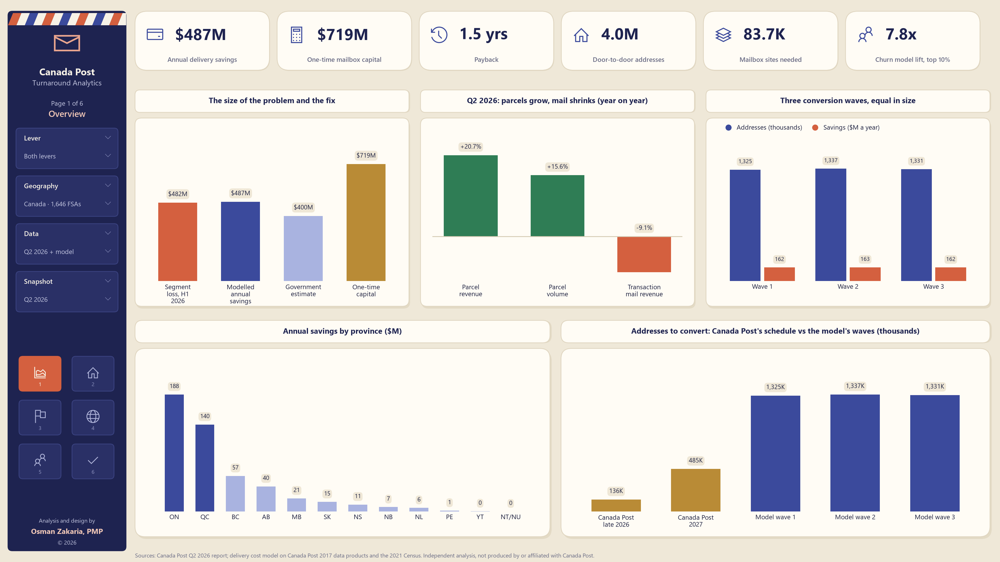
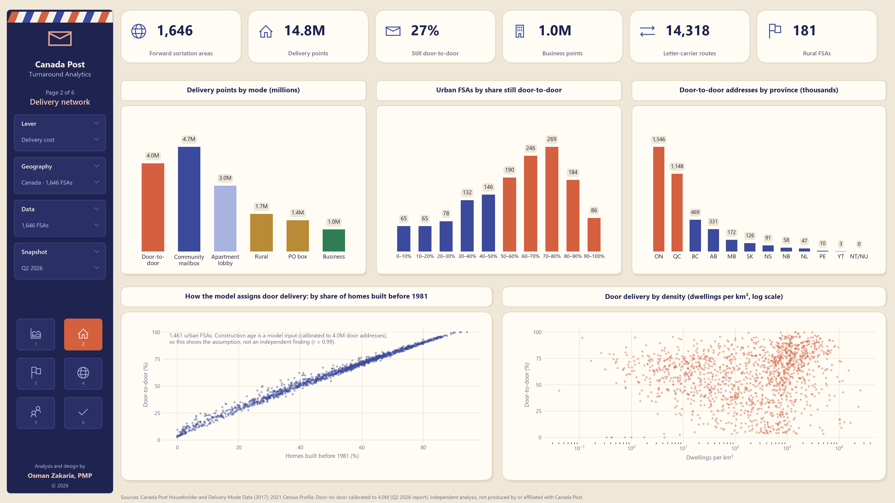
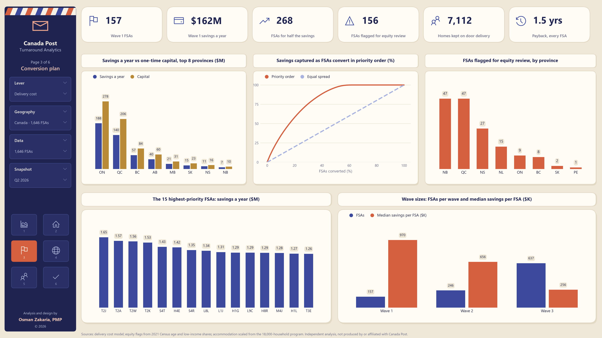
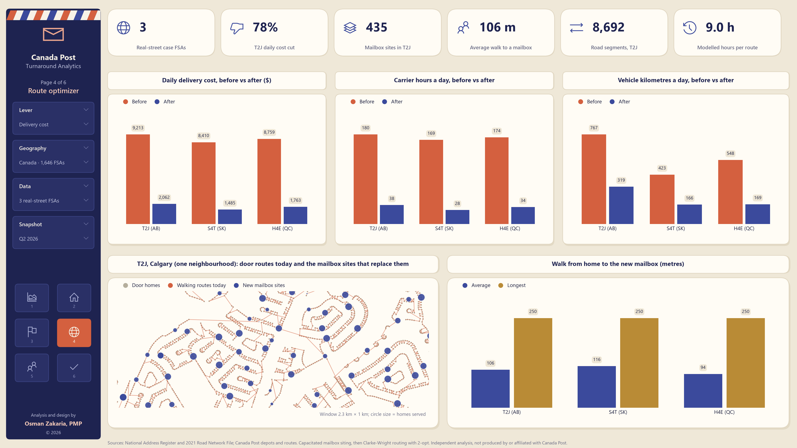
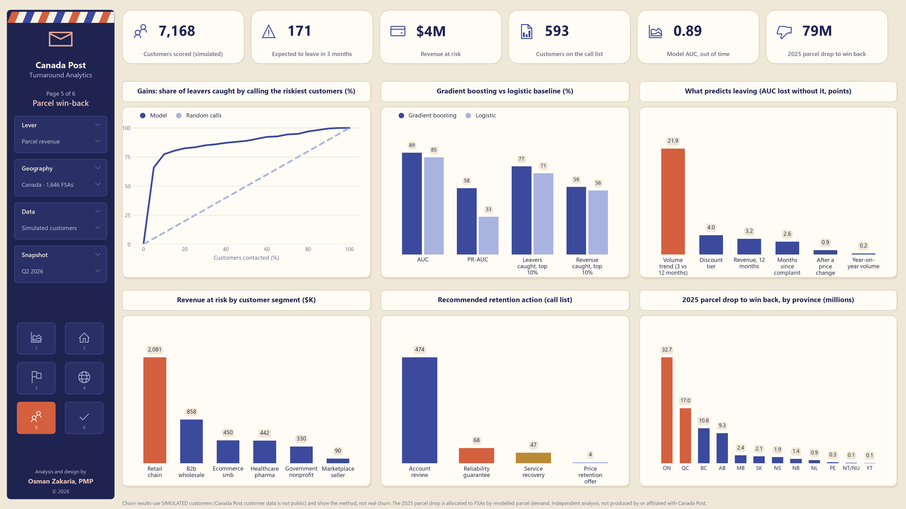
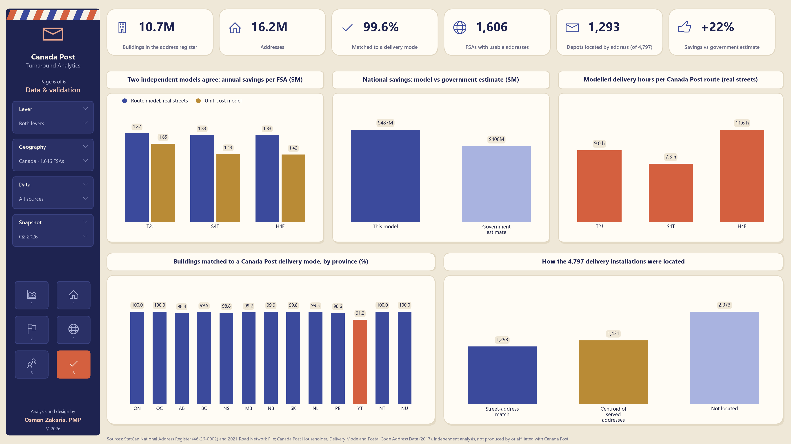

# Canada Post Turnaround Analytics

Two levers from the turnaround plan, built end to end on public data plus Canada Post's own
data products:

1. **Cut delivery cost.** A cost model for all 1,646 postal Forward Sortation Areas (FSAs), a
   prioritized door-to-door → community mailbox (CMB) conversion plan, and an optimization
   engine that sites CMBs on real addresses and re-routes delivery from real depots.
2. **Win back parcel customers.** A churn early-warning model that ranks business customers
   by revenue at risk, explains why each one is at risk, and recommends the retention action
   with the best expected value. The 79 million-piece (32.6%) drop in 2025 parcel volume is
   allocated across FSAs by modelled parcel demand to set win-back sales targets.

**Live dashboard:** https://claude.ai/artifact/J7girjpym3SAGt3zXGScmi

Independent analysis, not produced by or affiliated with Canada Post.

## Findings

| | |
|---|---|
| Door-to-door addresses (calibrated to the Q2 2026 report) | 4.0M of 14.8M delivery points |
| Annual saving from converting them to community mailboxes | $487M (government estimate: close to $400M) |
| One-time mailbox capital | $719M, a payback of 1.5 years |
| Mailbox sites needed | 83,700, in three waves of about 1.33M addresses each |
| Real-street case studies (Calgary T2J, Regina S4T, Montreal H4E) | Daily delivery cost down 78–82%; average walk to a mailbox 94–116 m |
| Parcel churn model (simulated customers) | AUC 0.89 out of time; calling the riskiest 10% catches 77% of leavers |

## Dashboards

Six 16:9 report pages in [`docs/dashboards/`](docs/dashboards/), also bound together in [`canada_post_turnaround_dashboards.pdf`](docs/dashboards/canada_post_turnaround_dashboards.pdf).

### 1 · Overview
The Q2 2026 position, modelled savings against the government estimate, the three conversion waves, savings by province, and Canada Post's own schedule.



### 2 · Delivery network
Delivery points by mode, how much of each FSA is still door-to-door, door addresses by province, and door delivery against construction age and density.



### 3 · Conversion plan
Savings against capital by province, how quickly savings accrue in priority order, equity flags, the 15 highest-priority FSAs, and wave sizes.



### 4 · Route optimizer
Before-and-after cost, carrier hours and vehicle kilometres on real streets, a map of door routes replaced by mailbox sites in Calgary, and walking distances.



### 5 · Parcel win-back
The churn model's gains curve and comparison with a logistic baseline, what predicts leaving, revenue at risk by segment, recommended actions, and the 2025 parcel drop by province. Customers are simulated.



### 6 · Data & validation
The route model against the unit-cost model, national savings against the government estimate, modelled hours per route, address-matching rates, and how depots were located.



## Run it

```bash
python -m pip install -r requirements.txt
```

The input files are not in this repository (they are large, and the Canada Post data products are licensed). Put the files listed under **Inputs** in the repository root before running.

```bash
python run_all.py
```

- **First run:** about 20 minutes. It parses the census zips, the Canada Post files and the National Address Register (10.7M buildings, 16.2M addresses), and caches them in `data/`.
- **Later runs:** about 10 minutes, mostly real-address routing.
- **Options:** `--rebuild` re-reads every zip; `--dashboard` rebuilds only the dashboard, in seconds; `--report` redraws only the six report pages (`outputs/dashboards/`), in seconds.
- **Viewing:** open `outputs/dashboard.html` in any browser. It is self-contained and works offline.

## Inputs

The zips are read in place and never modified.

| File | Used for |
|---|---|
| `No_CI_File_ for_ Analysi_98-401-X2021013_eng_CSV.zip` | 2021 Census Profile per FSA: dwelling type, construction period, age, income, work-from-home, industry |
| `File_for_Analysis_98-401-X2021013CI_eng_CSV.zip` | 95% confidence intervals per FSA, used to flag unreliable sample estimates |
| `File_for_Analysis2_98-401-X2021003CI_eng_CSV.zip` | CMA/CA income with confidence intervals (`data/cma_context.csv`) |
| `Road network file.zip` (despite the name) | StatCan **National Address Register** (table 46-26-0002, released June 26, 2026): 10.7M buildings and 16.2M addresses in all 13 provinces and territories, each with its mailing postal code (98–100%), building use and rural delivery information. **This is the main address source.** |
| `lrnf000r21a_e.zip` | StatCan **2021 Road Network File**: 2.24M road segments, used for street distances in the real-address case studies |
| `ODA_*_v1.zip` (10 provinces/territories) | StatCan Open Database of Addresses (2021). Fallback address source, used only if the National Address Register is absent |
| `Boundary_File_lfsa000a21a_e.zip` | StatCan 2021 FSA Boundary File: assigns ODA fallback addresses to FSAs by point-in-polygon, maps FSAs, and gives land area and density |
| `hh-householder-data-samples.zip` | Canada Post **Householder Data**: points of call (houses, apartments, businesses, farms) for every route and delivery mode, by FSA, plus each installation's street address |
| `dmd-delivery-mode-data-samples.zip` | Canada Post **Delivery Mode Data**: delivery mode type and route for 902K postal codes |
| `pcad-postal-code-address-data-samples.zip` | Canada Post **Postal Code Address Data**: 1.8M civic number ranges → postal code and installation. It also contains copies of the three zips above |
| `2026_Q2_report_en.pdf` | Canada Post Q2 2026 report: financials, conversion schedule, accommodation program (figures entered in `config.Q2_2026`) |

Not used: `hhe-householder-elite-data-samples.zip` (the same counts at postal-code level), and `PC_GEO.zip` and `pccf_may2020_sample.txt.zip` (samples of ~100 rows only).

**About the Canada Post files:** the release is effective 2017-07-17. Door-to-door conversions were frozen from 2015 to 2025, so 2017 delivery modes are close to the network the 2026 program starts from. Check the licence terms of these files before sharing results built on them.

## How the data fits together

- **Delivery points per FSA** come from Canada Post Householder counts:
  - Covered: 1,629 of 1,646 FSAs. The other 17, created after 2017, use census counts.
  - National totals: 14.8M residential points, 1.0M business points, 14,318 letter carrier (LC) routes.
  - Against the census: correlation 0.98, totals 9% lower.
- **Door-to-door candidates** are LC houses plus duplex flats. Suburban-service, lock-box and rural points are already centralized.
- **Which candidates are still door-to-door** follows census construction period. One factor is calibrated so the national total is 4.0M, the figure in the Q2 2026 report.
- **Accommodation** uses the program's current size: about 18,000 households (Q2 2026), as a share of households already on centralized delivery, scaled by the FSA's share of maintainers aged 75+.
- **Each building gets a delivery mode and LC route** directly from its mailing postal code, through Canada Post's Delivery Mode Data. For the ODA fallback, this is done by matching number ranges instead (72%).
  - The address's own delivery information overrides the mode: RR becomes rural route, SS becomes suburban service, PO BOX becomes PO box.
  - Postal codes created after 2017 are new developments, already on mailboxes.
  - Non-residential buildings (building use 3) are left out of the conversion.
  - Delivery mode then decides each building's role:

  | Mode | Treated as |
  |---|---|
  | A (block face) | Home |
  | B (apartment building) | Lobby |
  | T (suburban service), N (new since 2017) | Already centralized |
  | Business, PO box, rural | Left out |

- **Depots** are geocoded from the Householder installation addresses: 1,293 of 4,797 installations matched by street address against the National Address Register; the rest use the centroid of the addresses they serve. See `outputs/depots.csv`.

## Outputs (`outputs/`)

| File | What it is |
|---|---|
| `dashboard.html` | Interactive dashboard: Q2 2026 position, delivery network, route optimizer, churn, win-back, method |
| `delivery_conversion_plan.csv` | Per FSA: points by mode and source, door candidates and share, accommodation, savings, capital, payback, CMB sites, LC routes, main depot, equity flag, wave, priority, parcel demand, density |
| `delivery_by_province.csv`, `delivery_summary.json` | Province roll-up; national totals and calibration |
| `route_optimization.json` | Mailbox sites, routes and before/after costs for the case-study FSAs, with Canada Post route counts and depot |
| `depots.csv` | Every Canada Post delivery installation with its address and coordinates |
| `address_fsa_coverage.csv`, `oda_summary.json` | Address coverage and delivery-mode rate per FSA; address-source summary |
| `churn_call_list.csv`, `churn_scores_all.csv`, `churn_metrics.json` | Sales call list, all scores, out-of-time evaluation |

## Code (`cpost/`)

- `config.py`: every assumption in one place, plus the Q2 2026 figures.
- `census.py`: streams the census CSVs from the zips into one row per FSA, and adds land area from the boundary file.
- `canadapost.py`:
  - Parses the three Canada Post products. Layouts follow Canada Post's technical specifications, except the address-range file, whose positions were inferred from the records.
  - Matches addresses to postal codes and routes.
  - Geocodes installations.
- `nar.py`: National Address Register → one row per building with units, building use, postal code and Statistics Canada Lambert (EPSG:3347) coordinates, then the Canada Post mode by postal code.
- `roads.py`: Road Network File → street graph (densified every 25 m) → shortest-path distances, cached per source.
- `addresses.py`: ODA fallback, with FSA assignment by point-in-polygon and number-range matching.
- `delivery.py`: delivery points by mode, door-to-door calibration, accommodation, savings, waves, equity flags, parcel demand.
- `optimizer.py`:
  - **CMB siting:** capacitated facility location. Greedy maximum coverage, then a min-cost-flow optimal assignment, then closing surplus sites and re-centring the rest.
  - **Routing:** Clarke-Wright savings, then 2-opt, then inter-route relocation, under shift-time limits.
  - **Real-address cases:** run the whole FSA in carrier zones from the FSA's main Canada Post depot, and assign door-to-door by whole LC route.
  - **Synthetic grids:** remain for FSAs without address data.
- `churn.py`: monthly-panel features, calibrated gradient boosting against a logistic baseline, reason codes, and expected-value actions.
- `dashboard.py`: the HTML dashboard.
- `report.py`: the six report pages (PNG at 220 dpi, plus one PDF), drawn from the files in `outputs/`.

Analysis and design by Osman Zakaria, PMP · © 2026 Osman Zakaria, PMP

## Validation built in

- **Savings vs the government:** the model gives $487M a year against the government's estimate of close to $400M.
- **Route model vs cost model:** for each case-study FSA, the route model (labour and vehicle, on real streets) and the unit-cost model are within about 30% of each other.
  - On real streets the route model comes out 13–29% *higher* (T2J $1.87M vs $1.65M, S4T $1.83M vs $1.43M, H4E $1.83M vs $1.42M), so the $487M headline is the conservative figure.
- **Workload vs Canada Post's routes:** dividing the model's "before" workload by Canada Post's actual number of letter carrier routes gives 7–12 delivery hours per route on real streets, versus 5–8 with straight-line distances.
  - Real carrier street time is shorter than that, so the door-to-door walking assumptions (14 s per door, 4.5 km/h, walk from the sidewalk to every door) run high, especially in dense Montreal plexes (H4E).
  - Canada Post's own route measurement data would calibrate this.

## Important caveats

- **Churn customers are simulated.** Canada Post customer data is not public. The metrics describe the method on a simulation. To use real data, call `churn.run(profile, customers, monthly)` with:
  - `customers`: `customer_id, segment, fsa, contract_type, renewal_month, api_integrated, account_manager, discount_tier, tenure_months_at_start`
  - `monthly`: `customer_id, month (YYYY-MM), parcels, revenue, on_time_pct, complaints, claims, rep_contact`
- **Door-to-door vs CMB is still estimated.** Neither Canada Post file flags it: both count as letter carrier delivery. This is the first internal field to request.
- **Unit costs** (door $284, CMB $162) come from Canada Post's 2025 Annual Report. Lobby and rural costs are assumptions.
- **Distances.** Inside each carrier zone they are real street distances, with the walk measured from the sidewalk (6 m off the centreline) to each building. Depot legs, and points more than 300 m from a road, use straight line × 1.3. Synthetic-grid cases use exact grid distances.
- **Data dates:** the Canada Post data is from 2017. Routes and FSA boundaries have changed since, and some installations are unmatched or ungeocoded.
